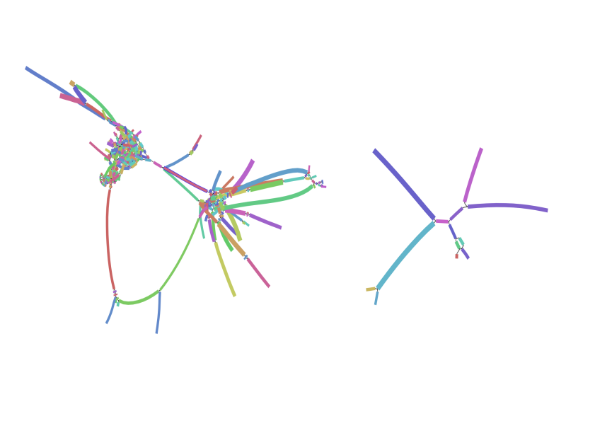

# Tribbles

When assembling target capture data from polyploids, assembly graphs often develop complex, dense entanglements known in `NextPyper` as **tribbles**.

---

## What is a "Tribble"?

Inspired by the [Star Trek](https://en.wikipedia.org/wiki/Tribble) creature known for its uncontrolled multiplication, a **tribble** refers to an assembly graph component that has exploded into a dense swarm of bubbles and dead-ends. 

In polyploids, reads originating from separate subgenomes (homoeologs), gene families (paralogs), or conserved domain motifs can co-assemble into the same graph component. When visualized in tools like Bandage, these components exhibit a characteristic "furry" appearance saturated with alternative paths (see the left component of the figure above).

A single tribble component can give rise to a combinatorial number of alternative paths (sequences) which hinders the recovery of the correct variants.

---

## Tribbles & chimeras

The primary danger of tribbles is the formation of **chimeric sequences**. 

Since graph components are parsed and interpreted to extract the biological sequences they represent, the more *tribblesome* they are, the harder it becomes to find the biological sequences amidst the plethora of alternative paths. 

Furthermore, an incorrect path traversal in this context, means the formation of a chimeric sequence (for instance by mixing homoeologous or paralogous domains). 

Chimeric sequences introduce noise into downstream phylogenetic analyses, misrepresenting subgenome origins and falsely inflating genetic variation.

---

## How NextPyper tackles tribbles

`NextPyper` aims to reduce tribble formation using a reassembly strategy for the loci that turned out to be more *tribblesome* (prone to becoming tribbles). Briefly, `NextPyper`:

ToDo: revisit

1. **Tribble identification**: `NextPyper` monitors the initial SAUTE assembly and flags components and loci that generate an excessive number of variants (by default, >10 variants per component).
2. **Targeted read isolation**: Reads associated with tribblesome loci are collected by mapping with `minimap2` and taking the properly paired reads.
3. **Stringent re-assembly**: The isolated reads are reassembled with SAUTE using tighter parameters:
   - Primary $k$-mer size is reduced to 70% of the initial value.
   - Seed coverage threshold is increased to 50% of the seed length (up from 20% in the first assembly).
4. **Chimeric flagging**: If a component remains complex after re-assembly, the number of output variants is capped to the top variants by $k$-mer coverage, and sequences are explicitly flagged in their FASTA description header with `[tribble=positive]` to alert the user of potential chimeric risk.

::: {.callout-note}
You can control or disable the tribble re-assembly stage using the `--no-reasm` option when running `nextpyper run`. See [Run options](../06-Advanced-usage/01-run_options.qmd) for more details.
:::