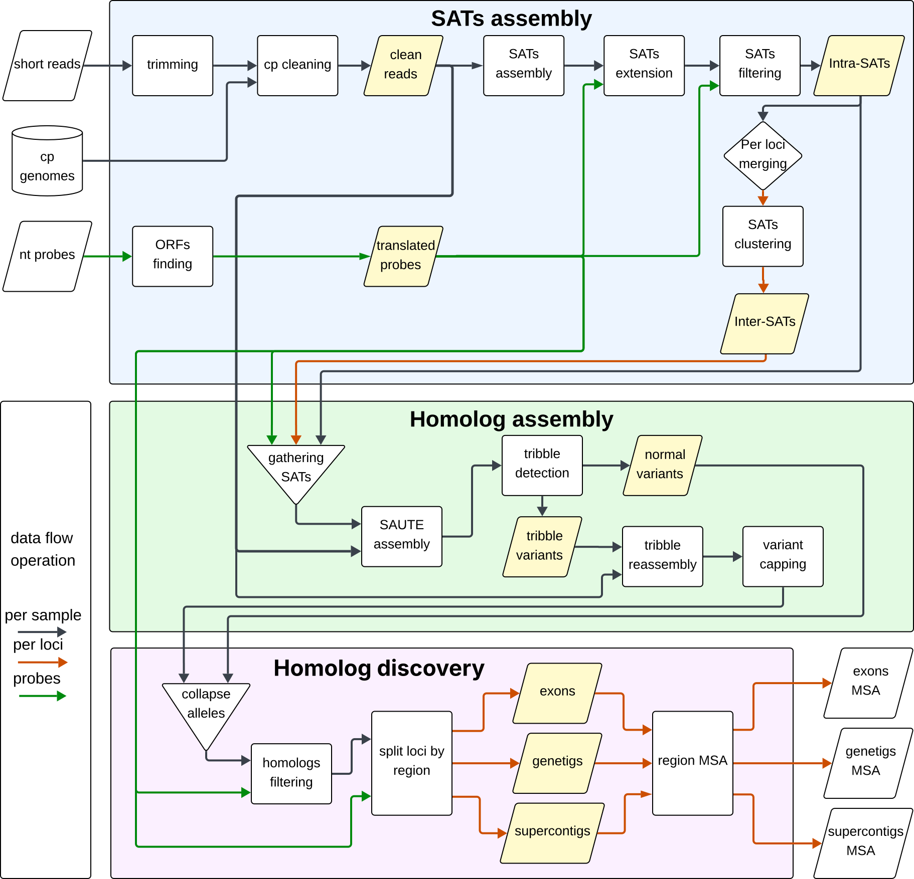

# Workflow overview

`NextPyper` orchestrates a 4-stage pipeline managed by [Snakemake](https://snakemake.github.io/) to process raw target capture reads into aligned, homoeolog-resolved loci.

---

## The 4 pipeline stages

### Stage 0: reads & probes processing
- **Read quality trimming**: Trims adapters and low-quality bases from paired-end sequencing reads.
- **Reads cleaning**: Remove plastid (or other) contaminants by mapping the sample reads to plastid (or custom) reference sequences.
- **Probe set translation**: Translates the probe set keeping the longest ORFs for downstream analyses.

---

### Stage 1: SATs assembly

- **Preliminary de novo assembly**: Reads from each sample are first assembled with MetaSPAdes, which excels at producing accurate scaffolds under uneven coverage.
- **Probe matching**: Identifies scaffolds matching target probes, whose origin is traced back to the assembly graph components. 
- **Path extension**: Scaffolds (paths on the assembled graph components) are extended across the graph topology following the matched probes generating sample-specific seeds (intraseeds).
- **Seeds filtering**: Seeds are filtered based gc-content, depth, and similarity to the probe sequence.
- **SATs clustering**: Seeds of all samples are grouped by locus and clustered at 95% similarity. A sequence representative is chosen for each cluster making the pool of interseeds. 
- **Gather SATs**: Depending on `--interseeds` mode, none of, a subset of related samples, or the whole pool of interseeds is used to complement the intraseeds and make the final SAT set for each sample.

---

### Stage 2: Homolog assembly
- **SAUTE guided assembly**: Assembles reads using the samples' SATs to guide path exploration and recover target exons, introns and flanking regions.
- **Tribble detection**: Identifies tribble components by looking at loci producing excessive number of variants.
- **Tribble re-assembly**: Re-assembles reads from tribble loci with more stringent parameters to reduce complexity and chimera formation.
- **Variant capping**: Variants from the remaining tribble components are capped to the maximum allowed number of variants, tagged as putative chimeric and merged back with the rest of the assembled variants.

---

### Stage 3: Homolog discovery
- **Allele selection**: Variants are clustered at 99% similarity and a single representative sequence is selected per cluster. This set of surviving sequences are called the homologs.
- **Homologs filtering**: Similarly to `Seeds_filtering`, homologs are filtered based on gc-content, depth, similarity to the probe sequence *and* probe coverage.
- **Exon-intron boundary detection**: Aligns homologs to the best global matching probe sequence using `miniprot` to accurately identify exon and intron boundaries, and split them into non-overlapping sets (regions).
- **Output Versioning**: Generates three output formats per locus: **Exons**, **Genetigs** (exons + introns), and **Supercontigs** (the full sequence, including flanking regions).
- **Locus Alignments**: Computes multiple sequence alignments (MSAs) per region across all processed samples.